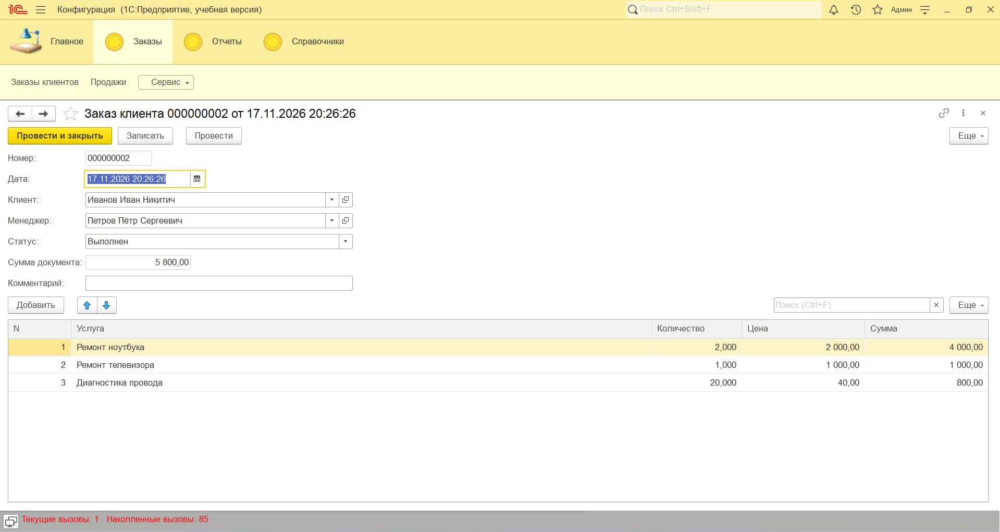
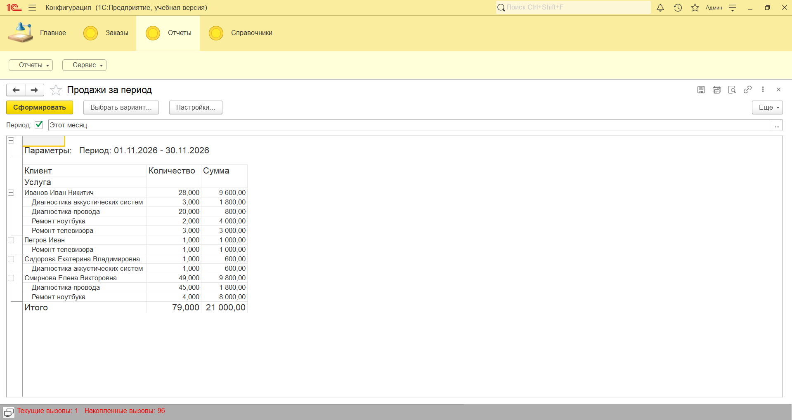
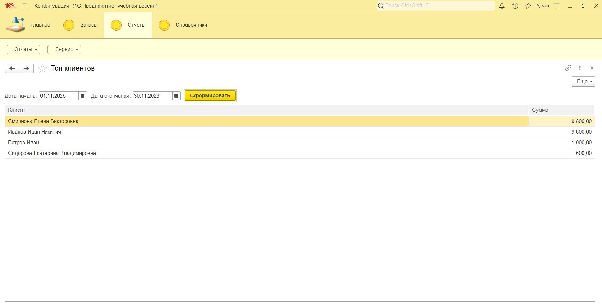

# Учёт заказов мастерской (учебный проект на 1С:Предприятие 8.3)

Небольшая конфигурация для учёта клиентов, услуг и заказов. Сделана самостоятельно как учебный проект при переходе из фронтенд-разработки в 1С. Цель проекта: пройти полный путь от справочников до отчётов и обмена данными на реальной задаче.

> Платформа: 1С:Предприятие 8.3 (учебная версия, <укажите номер релиза>), режим: управляемое приложение.

## Скриншоты

| Заказ клиента | Отчёт «Продажи за период» | Топ-5 клиентов |
|---|---|---|
|  |  |  |

## Что реализовано

**Данные**
- Справочники: **Клиенты**, **Услуги** (артикул, цена, длительность, признак активности), **Сотрудники**.
- Перечисления: **ТипыКлиентов**, **СтатусыЗаказа** (Новый, В работе, Выполнен, Отменён).
- В модуле объекта клиента: заполнение даты регистрации при создании и проверка формата телефона при записи.

**Заказ клиента (документ)**
- Шапка: клиент, менеджер, статус, сумма. Табличная часть «Услуги» с количеством, ценой и суммой.
- Автоподстановка цены из справочника при выборе услуги и пересчёт сумм на форме (клиент и сервер разделены директивами `&НаКлиенте` / `&НаСервере`).
- Проверка при проведении: нельзя провести заказ без клиента или с нулевой суммой.
- Проведение записывает движения в регистр накопления **Продажи** (измерения: клиент, услуга, менеджер; ресурсы: количество, сумма).

**Отчёты**
- **Продажи за период** — на системе компоновки данных (СКД): группировка клиент → услуга, параметр «Период» в пользовательских настройках.
- **Топ-5 клиентов** — обработка с формой и запросом на языке 1С к виртуальной таблице регистра (`Обороты`).

**Обмен данными**
- **Загрузка услуг из CSV**: разбор файла, создание и обновление элементов по артикулу (повторная загрузка не создаёт дублей), построчная обработка ошибок.
- **Выгрузка заказов в JSON** за период: структура «заказ → позиции».

**Права доступа**
- Роли: **Администратор** (полные права), **Менеджер** (работа с клиентами и заказами), **Руководитель** (просмотр данных и отчёты).

## Структура объектов конфигурации

```
Справочники    Клиенты, Услуги, Сотрудники
Перечисления   ТипыКлиентов, СтатусыЗаказа
Документы      ЗаказКлиента
Регистры       Продажи (накопления, обороты)
Отчёты         ПродажиЗаПериод
Обработки      ТопКлиентов, ЗагрузкаУслугИзCSV, ВыгрузкаЗаказовВJSON
Роли           Администратор, Менеджер, Руководитель
```

## Как запустить

**Вариант 1: из выгрузки базы**
1. Установите платформу 1С:Предприятие 8.3 (подойдёт бесплатная учебная версия).
2. Создайте новую информационную базу из файла `/dist/<имя-файла>.dt`: «Добавить → Создание новой информационной базы → Из выгрузки».
3. Откройте базу в режиме «1С:Предприятие».

**Вариант 2: из исходников**
1. Создайте пустую базу и откройте её в Конфигураторе.
2. «Конфигурация → Загрузить конфигурацию из файлов» и укажите папку `/src`.
3. Обновите конфигурацию базы данных (F7) и запустите (F5).

Пользователей создайте в Конфигураторе («Администрирование → Пользователи») и назначьте роли из списка выше.

## Тестовые данные

В папке `/samples` лежит `uslugi.csv`. Загрузить его можно обработкой «Загрузка услуг из CSV». Формат: разделитель `;`, кодировка UTF-8, колонки `Артикул;Наименование;Единица;Цена;Длительность`.

## Ограничения

- Проект учебный и создан на учебной версии платформы. Она не позволяет полноценно публиковать конфигурацию и использовать HTTP-сервисы, поэтому обмен данными сделан файловым (JSON), а HTTP-сервис не реализован.
- Цена хранится в справочнике «Услуги». В реальной системе её ведут регистром сведений по датам.
- Единица измерения хранится строкой, а не справочником.

## Идеи развития

- Регистр сведений «Цены услуг» с историей изменения.
- Загрузка заказов из JSON (обратная операция).
- Ограничение доступа на уровне записей: менеджер видит только свои заказы.
- Расширение вместо правки основной конфигурации.
